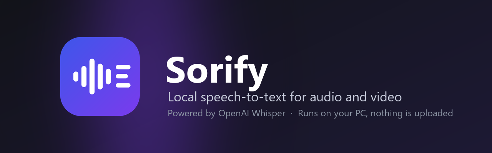
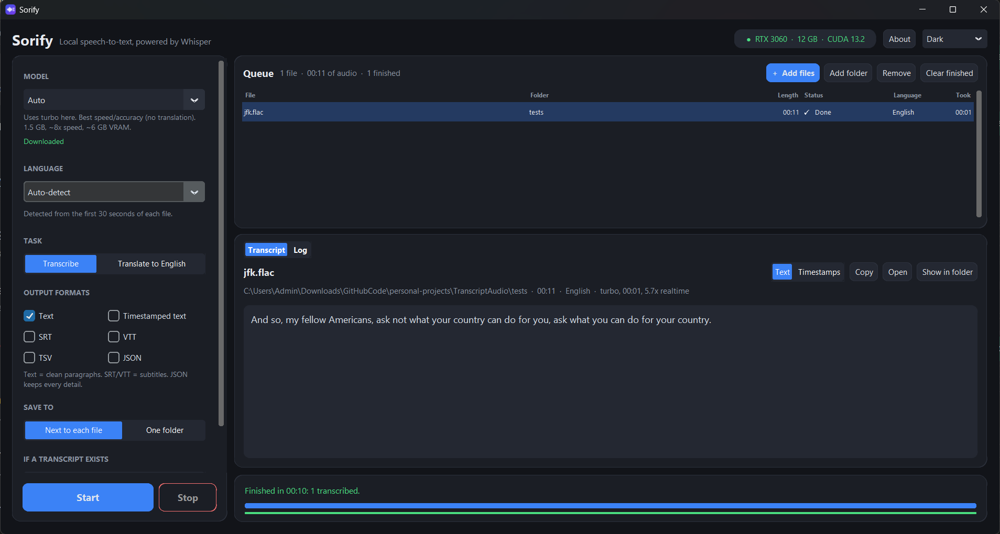
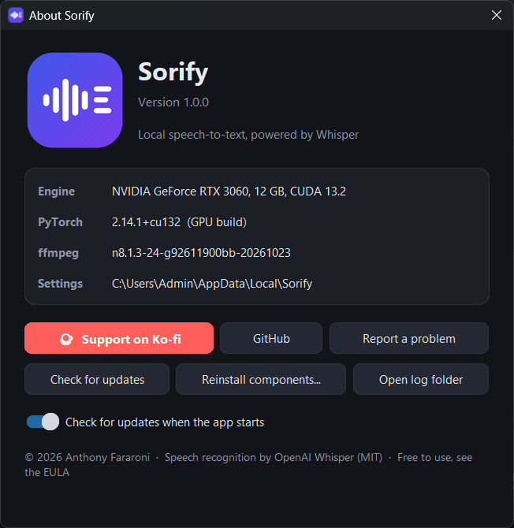

<p align="center">
  
</p>

<p align="center">
  <a href="https://github.com/AnthonyFararoni/Sorify/releases/latest"></a>
  
  <a href="https://ko-fi.com/anthonyfararoni"></a>
</p>
<p align="center">
  
  
  
  
</p>

**Sorify** turns audio and video files into text on your own PC. Drop files on the window, press **Start**, and get clean paragraphs, timestamped text or subtitles. It is built on [OpenAI Whisper](https://github.com/openai/whisper), runs on your NVIDIA GPU when there is one and on the CPU otherwise, and never uploads your recordings.

<p align="center">
  <a href="https://github.com/AnthonyFararoni/Sorify/releases/latest"><b>⬇ Download the latest installer</b></a>
  &nbsp;·&nbsp; Windows 10 / 11, 64-bit &nbsp;·&nbsp; free for personal and commercial use
</p>

<p align="center">
  
</p>

## Highlights

- **Drag and drop** files or whole folders (sub-folders included). 30+ formats: mp3, wav, m4a, aac, flac, ogg, opus, wma, mp4, mkv, mov, webm, avi, ts and more. Video files use their audio track.
- **Live transcript** appears while the file is being decoded, as paragraphs or with timestamps.
- **Every Whisper model**, from `tiny` to `large-v3`. *Auto* picks `turbo` on a GPU and `base` on the CPU; the panel shows each model's download size, speed and GPU memory need.
- **99 languages**, detected per file or chosen by hand, plus *Translate to English*.
- **Outputs**: text paragraphs, timestamped text, SRT, VTT, TSV and full JSON (segments and words). Save next to each file or into one folder; existing transcripts are skipped unless you choose *Overwrite*.
- **Pro options**: beam search or fast greedy decoding, word-level timestamps, subtitle line width (e.g. 42 for two-line captions), a vocabulary prompt for names and jargon, a switch for repetition loops.
- **Right-click → Transcribe with Sorify** in Explorer, and a `sorify` command for batch jobs from any terminal.
- **Private by design**: after setup it works offline. Files and transcripts stay on your disk.
- **Self-updating**: checks GitHub Releases at launch and asks before installing (*Update now · Remind me later · Skip this version*).

## Install

1. Download **`Sorify-Setup-x.y.z.exe`** from the [latest release](https://github.com/AnthonyFararoni/Sorify/releases/latest).
2. Run it. It installs for the current user only (no administrator rights) into `%LocalAppData%\Programs\Sorify`.
3. Pick the extras you want: desktop shortcut, Explorer right-click menu, `sorify` on PATH.
4. After the files are copied, Setup downloads the components that are too big to ship: **PyTorch** (about 2 GB for the GPU build, 120 MB for the CPU build), **Whisper** and **ffmpeg** (80 MB). A small window shows the progress.
5. The first transcription downloads the speech model you picked (`turbo` 1.5 GB, `base` 140 MB). Models are kept in `%UserProfile%\.cache\whisper` and are shared with any other Whisper tool on the PC.

> **"Windows protected your PC"** — the installer is not code-signed yet (certificates are expensive for a free app), so SmartScreen shows this warning the first time. Click **More info → Run anyway**. You can verify the download first: every release lists its SHA-256 in `SHA256SUMS.txt`, and `certutil -hashfile Sorify-Setup-x.y.z.exe SHA256` prints yours.

### Requirements

| | Minimum | Recommended |
|---|---|---|
| Windows | 10 (1809) or 11, 64-bit | 11 |
| Disk space | 2 GB (CPU build) | 6 GB (GPU build + `turbo` model) |
| Memory | 4 GB | 8 GB |
| GPU | none (CPU mode) | NVIDIA GeForce 10-series or newer, driver 560+ (CUDA 12.6), 6 GB VRAM for `turbo` |
| Network | for setup, model downloads and updates | |

Without an NVIDIA GPU Sorify uses the CPU: `base` runs faster than real time on a modern CPU, `small` is a good balance, the large models are slow.

## Using Sorify

<p align="center">
  
</p>

**Queue.** Drop files or folders anywhere on the window, or use *Add files* / *Add folder*. Each row shows length, status, detected language and time taken. Right-click a row for *Open transcript*, *Show in folder*, *Transcribe again* and *Remove*. Double-click opens the transcript.

**Model.** *Auto* is right for most people. Use `medium` or `large-v3` when you need *Translate to English* (`turbo` does not translate). The `.en` models are English-only and a bit better at it on the small sizes.

**Language.** Auto-detection looks at the first 30 seconds of each file. Set the language when a short or accented recording is guessed wrong.

**Save to.** *Next to each file* writes `talk.txt` beside `talk.mp3`; *One folder* collects everything in one place (files with the same name from different folders get the folder name in front).

**Advanced.** *Accurate* uses beam search; *Fast* is greedy and roughly twice as quick. *Word-level timestamps* makes JSON word timings and better subtitle cuts. *Subtitle line width* re-cuts SRT/VTT captions. The *vocabulary prompt* tells Whisper how names and jargon are spelled. Switch off *Carry context between chunks* if a transcript starts repeating itself.

**Keyboard.** `Ctrl+O` add files · `Ctrl+Enter` start · `Esc` stop · `Delete` remove selected rows · `Ctrl+A` select all · `F1` about.

**Explorer.** With the right-click option installed, select one or more audio/video files, right-click (on Windows 11: *Show more options*) and choose **Transcribe with Sorify**. The files land in the queue of the open window.

### Models

| Model | Download | GPU memory | Speed | When |
|---|---|---|---|---|
| `tiny`, `tiny.en` | 72 MB | 1 GB | ~10× | quick rough drafts |
| `base`, `base.en` | 139 MB | 1 GB | ~7× | the CPU default |
| `small`, `small.en` | 461 MB | 2 GB | ~4× | good balance on CPU |
| `medium`, `medium.en` | 1.5 GB | 5 GB | ~2× | accurate, good translation |
| `large-v2`, `large-v3` | 2.9 GB | 10 GB | 1× | most accurate |
| `turbo` | 1.5 GB | 6 GB | ~8× | the GPU default: large-v3 accuracy, fast; no translation |

Speeds are relative to `large-v3` on a GPU, from the Whisper paper.

## Command line

With the *Add the `sorify` command to PATH* option, open a new terminal and:

```text
sorify talk.mp3                                   text next to the file, auto model and language
sorify lecture.mp4 D:\Recordings -r -m turbo -l es -f txt srt
sorify interview.m4a --task translate -m medium   English translation
sorify podcast\ -o C:\Transcripts -f json --word-timestamps
sorify --help                                     every option
sorify --gui                                      open the window
```

| Option | Meaning |
|---|---|
| `-m, --model` | `auto`, `tiny` … `large-v3`, `turbo` |
| `-l, --language` | `en`, `es`, `Spanish`, … (default: detect) |
| `--task translate` | translate speech into English text |
| `-f, --format` | one or more of `txt timestamps srt vtt tsv json` |
| `-o, --output-dir` | write everything here instead of next to each file |
| `-r, --recursive` | include sub-folders of the given folders |
| `--overwrite` | redo files that already have outputs |
| `--device cuda\|cpu` | force the GPU or the CPU |
| `--fast` | greedy decoding instead of beam search |
| `--word-timestamps`, `--max-line-width N`, `--prompt "…"`, `--no-context` | the Advanced options |

Exit code 0 when every file succeeded, 1 when some failed, 130 when stopped with Ctrl+C.

## Updates

Sorify checks GitHub Releases a few seconds after it opens (switch this off in *About → Check for updates when the app starts*; *About → Check for updates* still works by hand). When a newer version exists you see the release notes and choose **Update now**, **Remind me later** or **Skip this version**. *Update now* downloads the installer in the background, verifies its SHA-256 against the value GitHub publishes for the release, closes the app, runs a silent update and reopens Sorify. Updates never re-download PyTorch or ffmpeg unless the release says they changed.

## Privacy

Your audio, video and transcripts are processed on your computer and never leave it. Sorify connects to the internet only to download its components, speech models and updates, and to ask GitHub for the latest version (an anonymous request that carries the app's version number). There is no telemetry, no account and no analytics.

## Where things live

| What | Where |
|---|---|
| The app, its private Python runtime, PyTorch, ffmpeg | `%LocalAppData%\Programs\Sorify` |
| Settings | `%LocalAppData%\Sorify\settings.json` |
| Logs (useful when reporting a problem) | `%LocalAppData%\Sorify\logs` (*About → Open log folder*) |
| Speech models | `%UserProfile%\.cache\whisper` |

Uninstalling (Settings → Apps, or the Start menu entry) removes the app folder and asks whether to delete the settings. The model cache is left for other Whisper tools; delete it by hand to free the space.

## Troubleshooting

**Setup said the components were not installed.** The download was interrupted or the network blocked it. Open Sorify: it offers to download them again. The log is in `%LocalAppData%\Sorify\logs\setup.log`.

**The device chip says "CPU mode" although I have an NVIDIA GPU.** Setup picks the GPU build when the NVIDIA driver reports CUDA 12.6 or newer and the GPU is a GeForce 10-series (Pascal) or later. Update the driver from NVIDIA, then *About → Reinstall components*. GeForce 9-series and older cards are not supported by current PyTorch builds.

**"Not enough GPU memory".** Pick a smaller model (`small` needs 2 GB, `turbo` 6 GB) or switch *Run on* to CPU under Advanced.

**Wrong language detected.** Set the language in the sidebar; detection looks at the first 30 seconds only.

**The transcript repeats a sentence over and over.** Switch off *Carry context between chunks* under Advanced and transcribe again.

**Translation keeps the original language.** `turbo` cannot translate; use `medium` or `large-v3`.

**My antivirus flags the installer.** Unsigned installers are sometimes flagged by heuristics. Compare the SHA-256 with `SHA256SUMS.txt` in the release; if it matches, the file is the one published here. If your scanner still complains, please [open an issue](https://github.com/AnthonyFararoni/Sorify/issues) with its name and the detection it reports.

**Something else.** [Open an issue](https://github.com/AnthonyFararoni/Sorify/issues/new/choose) and attach `sorify.log` from the log folder.

## Support the project

Sorify is free and made in my spare time. If it saves you hours of typing, a coffee keeps the updates coming:

<p align="center">
  <a href="https://ko-fi.com/anthonyfararoni"></a>
</p>

Stars, bug reports and feature ideas are just as welcome.

## License

Sorify is free to use, including commercially, under its [End User License Agreement](LICENSE.md). It may not be redistributed, modified or reverse-engineered. This repository publishes the installer and documentation; the source code is not public.

Sorify downloads and uses open-source components under their own licenses: OpenAI Whisper (MIT), PyTorch (BSD), FFmpeg (LGPL), Python (PSF) and others listed in [THIRD_PARTY_NOTICES.md](THIRD_PARTY_NOTICES.md).

---

<p align="center">Made by <a href="https://github.com/AnthonyFararoni">Anthony Fararoni</a> · <a href="CHANGELOG.md">Changelog</a> · <a href="https://github.com/AnthonyFararoni/Sorify/releases">All releases</a></p>
